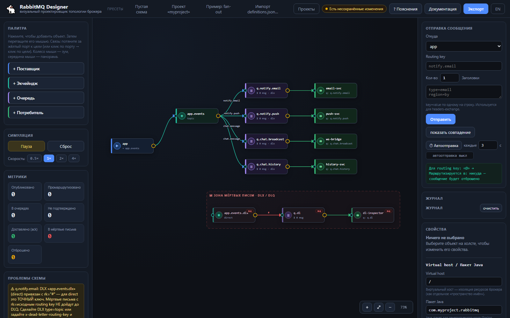

# RabbitMQ Designer

**Визуальный конструктор топологий RabbitMQ с живой симуляцией.** Соберите схему мышью, посмотрите, как по ней летят сообщения, и выгрузите готовый `definitions.json` или каркас на Spring AMQP.

Работает из папки, без сервера, без сборки и без интернета.

[](LICENSE)
[](#приватность-и-офлайн)
[](#быстрый-старт)
[](#)
[](#)



## Быстрый старт

1. Скачайте репозиторий: `git clone https://github.com/Gustafor/MQ-Designer.git`
2. Откройте `index.html` двойным кликом.

Всё. Node.js, npm, Docker и брокер не нужны — файлы лежат рядом, `index.html` подключает их относительными путями.

Если браузер запрещает `file://` (редко, в корпоративных политиках) — поднимите любой статический сервер:

```bash
python -m http.server 8000   # затем http://localhost:8000
```

**Онлайн-демо:** <https://gustafor.github.io/MQ-Designer.github.io/>

## Зачем это

Топологию RabbitMQ обычно проверяют в голове, на салфетке или на живом брокере — с риском сломать staging. Designer даёт третий путь: нарисовать схему, увидеть её поведение и только потом идти в код и в `rabbitmqctl`.

Типичные сценарии:

- **Разобраться в чужой топологии** — импортируйте `definitions.json` из брокера и посмотрите, куда что маршрутизируется.
- **Согласовать схему с командой** — выгрузите Markdown-документ или `.rmq.json`, не собирая скриншоты вручную.
- **Проверить DLX/DLQ и TTL до продакшена** — отправьте сообщение с нужным routing key и посмотрите, дойдёт ли оно до dead-letter очереди.
- **Начать Spring-проект** — сгенерируйте константы, конфигурацию и потребителей, а не переписывайте имена очередей из тикета.

## Возможности

| | |
|---|---|
| **Четыре типа узлов** | producer, exchange, queue, consumer |
| **Все типы exchange** | `direct`, `fanout`, `topic`, `headers` (с `x-match: all/any`) |
| **Bindings** | exchange → queue, exchange → exchange, с routing key или заголовками |
| **DLX / DLQ** | `x-dead-letter-exchange`, `x-dead-letter-routing-key`, `x-message-ttl` |
| **Симуляция** | prefetch, время обработки, доля ошибок, requeue, ack/nack, пауза, скорость 0.5–4× |
| **Метрики** | опубликовано, промаршрутизовано, в очередях, unacked, доставлено, мёртвые, отброшено |
| **Журнал** | построчно объясняет маршрут каждого сообщения |
| **Проблемы схемы** | циклы из exchange, висячие ссылки, DLX на самого себя, `rk="#"` на direct-DLX, дубли имён |
| **Экспорт** | `definitions.json`, Spring AMQP (Java + `application.yml`), Markdown-документация, ZIP |
| **Импорт** | `definitions.json` из реального брокера |
| **Проекты** | автосохранение в браузере, до 40 именованных схем, файлы `.rmq.json` |
| **Язык** | русский и английский, переключение на лету |

## Симуляция

Каждое сообщение — это объект с телом, заголовками и routing key. Движок повторяет правила брокера, а не упрощённую модель:

- `topic` — `*` (одно слово) и `#` (ноль или больше слов);
- `direct` — точное совпадение routing key;
- `fanout` — копия в каждую привязанную очередь, routing key игнорируется;
- `headers` — сравнение заголовков с учётом `x-match`;
- сообщение без совпадений **молча отбрасывается** (как в RabbitMQ) и попадает в счётчик «Отброшено»;
- ошибка обработки → `nack` → DLX, если он задан, иначе сообщение теряется;
- TTL очереди отправляет сообщение в DLX, не дожидаясь потребителя;
- prefetch ограничивает число сообщений «в полёте» у одного потребителя.

Панель «Проблемы схемы» подсвечивает конфигурации, которые в брокере приведут к сюрпризам: цикл exchange → exchange, DLX, привязанный к `rk="#"` у direct-exchange, DLX без bindings, DLQ со своим DLX (риск бесконечного цикла), headers-binding без заголовков, `auto_delete=true`, висячие ссылки на удалённые объекты.

## Экспорт

Кнопка **Экспорт** открывает предпросмотр и позволяет скачать по отдельности или одним архивом:

| Формат | Что внутри | Куда |
|---|---|---|
| `definitions.json` | users (опционально), vhosts, exchanges, queues, bindings, policies | `rabbitmqctl import_definitions` / Management UI |
| Spring AMQP | константы имён, `@Configuration` с бинами, конвертер JSON, publisher, потребители, `application.yml` | `src/main/java` проекта Spring Boot |
| Markdown | 14 разделов: схема, таблица маршрутов, DLX, чек-лист внедрения | Confluence, Git, тикет |

ZIP собирается через JSZip, который подгружается с CDN. Если сети нет (air-gap) — файлы просто скачиваются по одному, экспорт не ломается.

## Горячие клавиши

| Клавиша | Действие |
|---|---|
| `Ctrl` + `S` | сохранить проект |
| `Delete` / `Backspace` | удалить выбранный узел или связь |
| `Esc` | отменить соединение / снять выделение |
| `Space` + перетаскивание | панорама холста |
| колесо мыши | прокрутка холста, `Ctrl` + колесо — зум |
| `+` / `−` / `0` | приблизить / отдалить / вписать схему |
| `Enter` в поле ввода | применить значение |

## Автосохранение и проекты

Инструмент проектирования не имеет права терять работу, поэтому схема пишется в `localStorage` автоматически, с задержкой 600 мс после последнего изменения.

- **Индикатор в шапке** показывает состояние: «Сохранено», «Автосохранено», «Есть несохранённые изменения».
- **При перезагрузке** браузер спросит подтверждение, если схема менялась после явного сохранения, — но автосохранение всё равно восстановит её.
- **Автосохранение — отдельный слот на вкладку**: две открытые вкладки не затирают работу друг друга, а после перезагрузки восстанавливается состояние именно этой вкладки (новая вкладка подхватывает самое свежее).
- **Замена схемы** (пресет, импорт) при несохранённых изменениях спрашивает: сохранить проект, не сохранять или отменить.
- **Проекты** — именованные слоты в браузере (до 40) плюс выгрузка в `.rmq.json` для переноса на другую машину и для вложения в тикет.
- **Приватный режим** — если `localStorage` недоступен, приложение продолжает работать и честно предупреждает, что защита остаётся только на уровне предупреждения при уходе со страницы.

Формат `.rmq.json` — обычный JSON: `app`, `version`, `name`, `vhost`, `package`, `lang`, `exportIncludeUsers`, `nodes`, `links`.

## Приватность и офлайн

- Нет бэкенда, аккаунтов, телеметрии и аналитики.
- Нет сетевых запросов, кроме необязательной загрузки JSZip с CDN для ZIP-экспорта.
- Все данные остаются в `localStorage` вашего браузера и в скачанных вами файлах.
- Работает в изолированном контуре: скопируйте папку на машину без интернета — интерфейс, симуляция, экспорт и документация доступны полностью.
- Импортированный `.rmq.json` не исполняется: типы узлов и `exType` сверяются с белым списком, ids дедуплицируются, размеры ограничены, а все имена экранируются при выводе в интерфейс.

## Структура

```
index.html        — каркас страницы и подключение скриптов
style.css         — тёмная тема, печать в PDF
i18n.js           — строки RU + EN
presets.js        — пресеты: пустая схема, myproject, fan-out
core.js           — модель, маршрутизация, симуляция, валидация схемы
exporters.js      — definitions.json, Spring AMQP, Markdown
help-content.js   — справочник по RabbitMQ внутри приложения
storage.js        — автосохранение, проекты, защита от потери данных
render.js         — SVG-холст, инспектор, модалки, RAF-цикл
test-logic.js     — тесты логики (node test-logic.js)
test-rk.js        — тесты routing key, unit + e2e (node test-rk.js)
docs/             — иллюстрации для README
```

Никакой сборки: файлы подключаются как есть, порядок задан в `index.html`. Приложение намеренно написано на vanilla JS без фреймворка — это позволяет открывать его с `file://` и держать в одном каталоге.

## Тесты

```bash
node test-logic.js   # 41 проверка: симуляция, DLX/TTL, валидация файла, экспорт
node test-rk.js      # таблица маршрутизации: 46 unit + 17 e2e
```

Зависимостей нет: тесты — это обычные Node-скрипты, которые загружают `core.js` и проверяют результат. Оба скрипта возвращают ненулевой код при ошибке — их можно ставить в CI.

## Roadmap

Развитие продукта и решения по архитектуре — в [ROADMAP.md](ROADMAP.md). Ближайшее направление: убрать зависимость от CDN (нативный ZIP через `CompressionStream`), клавиатурная навигация по холсту, AI-помощник по схеме.

## Участие

- Правила, инварианты и стиль кода — [CONTRIBUTING.md](CONTRIBUTING.md).
- Об уязвимостях — приватно, через вкладку **Security** репозитория: [SECURITY.md](SECURITY.md).
- Идеи и баги — [Issues](https://github.com/Gustafor/MQ-Designer/issues).

## Лицензия

[MIT](LICENSE) — используйте свободно, в том числе в коммерческих проектах.
